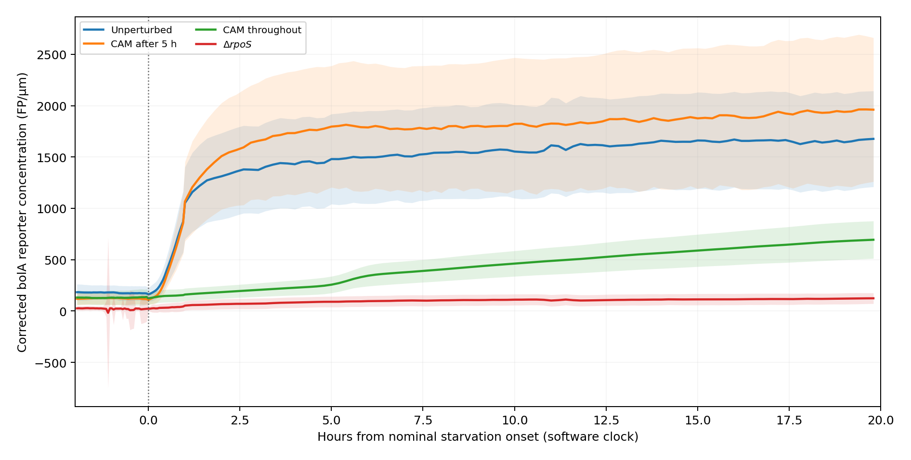
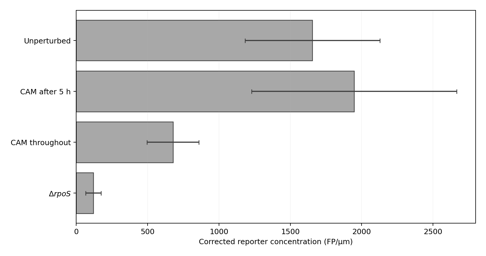
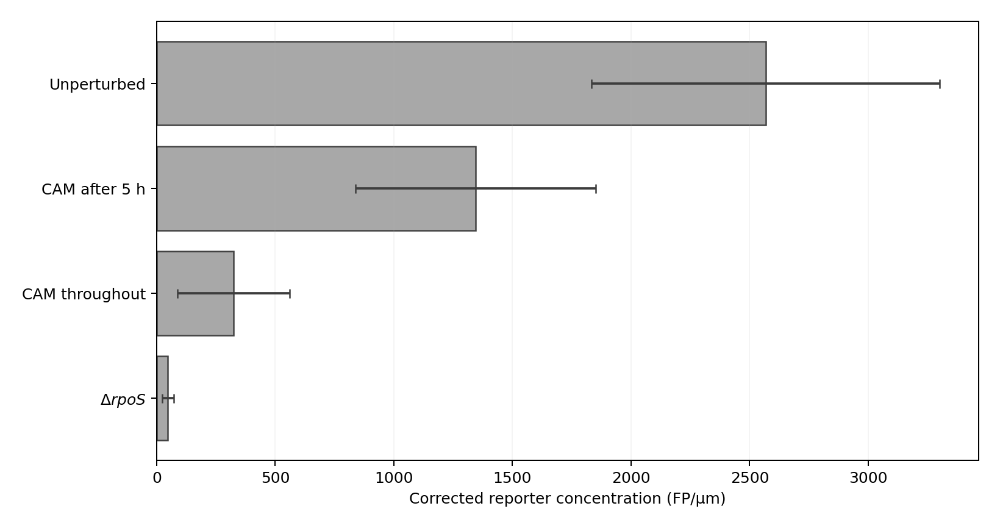
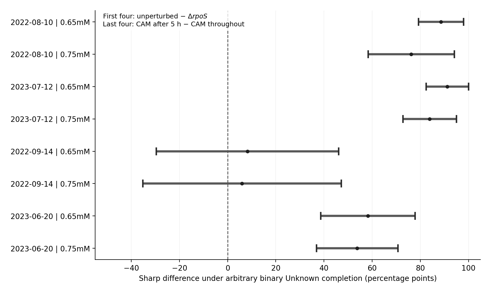
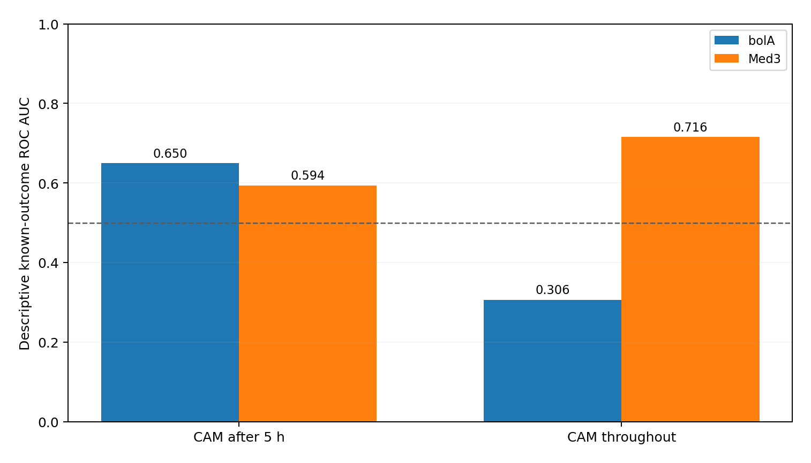

**Independent Researcher, Yangzhou, China**  
ORCID: [0009-0005-7165-0080](https://orcid.org/0009-0005-7165-0080)

**Scope.** A partial computational replication: an independent reimplementation of the published Figure 6B/C/D calculations and a data-specific audit of their software-defined denominators and observation identities. Figures are independently drawn from the authors' exported values; the source experiments are those of Gervais and colleagues [@Gervais2026].

# Introduction

The original study by Gervais and colleagues examined how carbon starvation remodels *Escherichia coli* physiology and changes recovery following a later hydrogen peroxide challenge [@Gervais2026]. Its Figure 6B summarizes source-defined growth and division outcomes during recovery, Figure 6C reports a corrected fluorescence concentration trajectory for the *bolA* reporter, and Figure 6D compares corrected *bolA* and Med3 reporter concentrations prior to oxidative stress.

The associated analysis inputs and scripts are publicly archived [@GervaisZenodo2025]. RealTrace supplies inferred, corrected reporter concentrations from microscopic measurements; that upstream inference method is described separately by Kscheschinski et al. [@Kscheschinski2025]. Prior work has also established that incomplete population-lineage trees can alter statistical selection [@Genthon2023], while verification-bias methods for ROC AUC typically rely on stated assumptions about unresolved labels [@He2009]. Our contribution is **specific to the observed software record and panel definitions**: an independently executable numerical reconstruction and finite-sample selection audit, not a new estimator theorem or a repeat of the original biological finding. Nevertheless, successful visual reproduction alone cannot establish that two panels refer to identical statistical populations. A longitudinal software tracking identifier can be present in a recovery panel but absent from a pre-challenge window. Multiple time points and two fluorophores may be recorded from a single software-tracked cell, and those are not independent experimental cultures.

Four questions organize this replication: (i) do independent calculations reproduce the published panel summaries; (ii) how do panel-specific inclusion rules and complete-case selection change denominators; (iii) which pooled and within-date contrasts remain ordered under unresolved outcomes; and (iv) how do alternative weights for source-ID partitions change a descriptive target? This organization keeps the original biology and the secondary sensitivity analysis distinct.

# Source materials and software procedures

## Source authentication and execution boundary

The original study produced the microscopy measurements, deepMoMA cell tables, RealTrace-corrected concentrations, and published R Markdown figures [@Gervais2026; @GervaisZenodo2025]. Table 1 summarizes the authenticated source inputs. Full 64-digit SHA-256 digests, the original ZIP MD5 and source-file sizes are stored in `SOURCE_SHA256.json`, which the independent software checks before processing. The official upstream archive is hosted at [Zenodo 18059846](https://doi.org/10.5281/zenodo.18059846) and is not redistributed here.

| Authentic source | Bytes | SHA-256 prefix |
|:--|--:|:--|
| Original stress Feather | 482,147,704 | `52c9cf4c7607ecd3…` |
| Original analysis Rmd | 207,248 | `7f915a34db6c3326…` |
| Selected RealTrace CSV.gz | 33,964,233 | `85623f172105e349…` |
| Complete upstream ZIP | 842,127,932 | `0697803959ffa64b…` |

Table: Verified inputs and their sizes. Full digests are provided in the repository manifest.

We first verified and reran the independent implementation on the source-selected Feather, Rmd and RealTrace records in CPython 3.13.5. A separate Google Colab session (CPython 3.13.18, 8 November 2026) validated the complete upstream ZIP with SHA-256, MD5 and all 21 member CRC checks, regenerated the RealTrace selection (1,347,150 rows), and completed the five-stage core calculation. In the present extended seven-stage replay (CPython 3.13.5), authenticated extracted members reproduce the four group proportions, 616 time summaries, eight reporter summaries, 1,145/1,139 cross-panel software-ID counts and exact missing-label intervals. The code reaggregates the original RealTrace-corrected output rather than recalibrating fluorescence from microscopy images. Original member provenance and the independent cloud receipt are separated in the accompanying validation records.

## Source-defined recovery endpoint (Figure 6B)

Following the original author's GM.2 recovery-stage filter, we selected software cycles born before recovery and meeting the original rank criterion. We preserved the original software outcome categories: `Survive` for observed source-defined division, `No Growth` for qualifying no-growth annotations, and `Unknown` when the record did not meet the source's criteria for either. We did not re-label `Unknown` as failure or infer colony-forming survival.

For each group, the author-style conditional recovery fraction was

$$
P_{\mathrm{known}} = \frac{S}{S+N},
$$

where $S$ is the count of source-defined surviving cycles, $N$ is the count of source-defined no-growth cycles, and $U$ is the unresolved count. The source plotting code calculates error-bar widths as $\sqrt{P_{\mathrm{known}}(1-P_{\mathrm{known}})/(S+N+U)}$, including unresolved records in the normalization even though the plotted fraction conditions on known outcomes. The published caption describes “fraction ± s.d.” over approximately 230–330 observed cells [@Gervais2026]. We reproduce the code-derived quantities and document their exact denominators; the caption alone does not specify a replicate-level estimator. A reference calculation using $\sqrt{P_{\mathrm{known}}(1-P_{\mathrm{known}})/(S+N)}$ illustrates the effect of excluding unresolved outcomes from the simple binomial denominator, without claiming this is a replacement for the published error bar.

## Corrected reporter summaries (Figures 6C and 6D)

The source RealTrace table contains `Corr_conc` and `Corr_conc_maturation` for two different reporter constructs. We reimplemented the author's observable and reporter selection. Figure 6C follows the *bolA* reporter over the nominal starvation interval; Figure 6D pools software cell-time records in the final two hours before nominal oxidative challenge, grouped by reporter and treatment condition. The numerical reaggregation matches the author's record-level descriptive standard deviations. The published Figure 6D legend identifies two independent experiments, two H₂O₂ concentrations and the individual replicates in Appendix Fig. S21 [@Gervais2026]. Our contribution is the source-row denominator and missingness audit beyond those published replicate displays; the present means and standard deviations are calculated from the exported software observations.

The reported times are software-relative times rather than separately checked hardware exposures or cell-local medium arrival times. No microscopy hardware timestamps, independently authenticated culture assignment, or local H₂O₂ exposure sensors were used in the present calculations.

## Units of observation and relationship to the original paper

The analysis unit is an exported software cycle in Figure 6B, a reporter-time observation in Figure 6C, and a reporter-by-cell-by-time record in Figure 6D. Different time points from one tracked cell contribute to the longitudinal summaries, whereas independent experimental preparations remain a separate unit [@Gervais2026; @Bakshi2021]. A software `cell` key supports an exact join between exported tables but is not a physically barcoded cell identity. Consequently, our pooled row-level SD is descriptive and is not a substitute for between-experiment uncertainty. These definitions apply throughout the analyses below.

The central reproducibility question is whether a fresh implementation recovers the *same computation*, including the source-defined eligibility changes among panels. We provide group count tables and exact software-ID crosswalks so the observed mismatch can be traced without switching denominators.

## Cross-panel matching and sensitivity analyses

We matched Figure 6B recovery cycles to Figure 6D pre-challenge reporter candidates by the exact exported software `cell` key, checking date, nominal dose and treatment agreement. We rejected many-to-many joins and retained unpaired cycles in the original Figure 6B denominators.

For a secondary, explicitly exploratory description, we averaged the preceding valid reporter concentrations within each software cell and calculated a pairwise rank statistic (ROC AUC) against known source-defined recovery/no-growth labels within the two CAM treatment arms. We used identical complete-case software populations for *bolA* and Med3. No prediction model was trained, there was no held-out test set for this diagnostic, and no significance claims are made.

For a second descriptive target, the exported software `cell` keys define **37 date × second-ID-component partitions** (verified against `ugl` in 1,153/1,153 source Feather records). Each partition contains a single treatment and nominal challenge dose, and the two CAM treatments occupy 17 partitions (7 delayed, 10 continuous). The second ID component is a software provenance field, not a verified independent culture. Within-date treatment contrasts and equal-weight provenance-partition means therefore answer different questions.

For each treatment $g$ and ID-derived partition $p$, let $S_p$, $N_p$, and $U_p$ count the three annotated fates and let $n_p=S_p+N_p+U_p$. Under unrestricted binary completion of `Unknown`, the *equal-partition* descriptive fraction has exactly attainable endpoints

$$
\underline{\mu}^{(\mathrm{pos})}_g = \frac{1}{m_g}\sum_{p\in g}\frac{S_p}{n_p},\qquad
\overline{\mu}^{(\mathrm{pos})}_g = \frac{1}{m_g}\sum_{p\in g}\frac{S_p+U_p}{n_p},
$$

where $m_g$ is the number of distinct source-ID partitions in treatment $g$. Each unresolved label enters with a positive fixed weight, so every minimum and maximum is attained by an assignment of those labels; for a contrast between treatments, the lower endpoint is the first arm's lower endpoint minus the second arm's upper endpoint. These are finite-record sensitivity bounds for a **different weighting estimand** than the source-cycle pooled fraction, not an estimate of population treatment effects or a cluster-adjusted confidence interval.

# Results

## Independent numerical replication of Figure 6B

The Figure 6B source-defined risk set contains **1,153** software cycles, compared with a different pre-stress landmark population analyzed elsewhere. The four author-style fractions are reproduced in Table 2 from source annotations, and Figure 1 shows the corresponding proportions.

| Treatment group | Survive | No Growth | Unknown | Known-outcome fraction |
|:--|--:|--:|--:|--:|
| CAM added after first 5 h of starvation | 108 | 59 | 65 | 64.67% |
| CAM throughout starvation | 42 | 176 | 110 | 19.27% |
| Unperturbed | 219 | 4 | 65 | 98.21% |
| $\Delta\mathit{rpoS}$ | 6 | 294 | 5 | 2.00% |

Table: Source-defined recovery counts and known-outcome fractions for Figure 6B.

{#fig:recovery width=92%}

For CAM after the first five hours, the plotted error-bar formula gives approximately 3.14 percentage points using 232 total cycles, compared with 3.70 points if 167 known-outcome cycles are substituted into the simple binomial expression. For CAM throughout, the corresponding values are 2.18 and 2.67 percentage points. Both calculations ignore clustering of software observations within lanes, imaging positions and experimental runs. The plot in Figure 1 intentionally follows the archived Rmd error-bar formula. Its all-cycle denominator differs from the known-outcome denominator defining bar height; both are reported explicitly rather than reinterpreted as a newly estimated experimental variance.

## Independent numerical replication of Figures 6C and 6D

The corrected *bolA* concentration trajectory was reconstructed into **616** grouped software time-point summaries, including the interval up to 20 hours of nominal starvation. Figure 2 shows the independent rendering of these calculations. The bands are source-observation standard deviations rather than independent-culture uncertainty.

{#fig:time-course width=95%}

Figure 6D requires two corrected reporter measurements per observation window. The **32,940 candidate reporter-by-time records** in the final two pre-stress hours yield **32,400** available corrected records in the verified RealTrace join, rather than 32,940 independently assayed cells. Table 3 gives the eight observed mean/SD summaries in corrected fluorescent proteins per micrometre (FP/µm). Figures 3 and 4 display the *bolA* and Med3 summaries, respectively.

| Treatment | *bolA* mean ± SD | Med3 mean ± SD |
|:--|--:|--:|
| Unperturbed | 1,655.6 ± 472.1 | 2,567.3 ± 733.0 |
| CAM added after 5 h | 1,947.3 ± 717.8 | 1,344.1 ± 506.0 |
| CAM throughout starvation | 678.6 ± 181.6 | 324.2 ± 237.0 |
| $\Delta\mathit{rpoS}$ | 120.6 ± 53.5 | 47.8 ± 24.6 |

Table: Corrected reporter concentrations calculated from source software records.

{#fig:bola-means width=92%}

{#fig:med3-means width=92%}

## Source-date and nominal-dose observation weighting (descriptive check)

The Figure 6D author output pools available reporter-by-cell-by-time observations within each treatment. As a separate audit of how record weighting affects these *descriptive* summaries, we partitioned its same 32,940 candidate records by the source `date` and nominal `STRESS` labels. There were 32 nonempty treatment × reporter × date × dose strata (four strata per treatment–reporter combination), containing 32,400 valid corrected concentrations from 1,710 distinct software `cell` identifiers. The two CAM regimens are recorded on 14 September 2022 and 20 June 2023; unperturbed and ΔrpoS records are from 10 August 2022 and 12 July 2023. The original article already provides individual experimental replicates in Appendix Fig. S21 [@Gervais2026]. Here the date-by-dose tabulations serve a different purpose: revealing how the pooled software-record weights and unresolved outcomes enter each summary.

For each of the eight Figure 6D treatment–reporter combinations, we compared the original record-weighted mean with the *arithmetic mean of its four date×dose stratum means*, assigning each observed stratum equal weight. This is a deliberately different descriptive weighting estimand, not a corrected standard error or alternative randomized treatment estimator.

| Treatment | Reporter | Figure 6D row-weighted mean (FP/µm) | Equal-stratum mean (FP/µm) | Shift vs. row-weighted |
|:--|:--|--:|--:|--:|
| CAM after 5 h | Med3 | 1,344.1 | 1,393.0 | +3.64% |
| CAM after 5 h | *bolA* | 1,947.3 | 1,961.1 | +0.71% |
| CAM throughout | Med3 | 324.2 | 328.9 | +1.47% |
| CAM throughout | *bolA* | 678.6 | 690.4 | +1.75% |
| Unperturbed | Med3 | 2,567.3 | 2,502.4 | -2.53% |
| Unperturbed | *bolA* | 1,655.6 | 1,622.3 | -2.02% |
| ΔrpoS | Med3 | 47.8 | 48.3 | +1.02% |
| ΔrpoS | *bolA* | 120.6 | 120.8 | +0.13% |

Table: Record-weighted and equal-date–dose-stratum Figure 6D descriptive means.

Absolute reweighting differences range from 0.13% to 3.64%; signed differences range from −2.53% to +3.64%. This confirms that the plotted estimates describe the author-selected pooled observation distribution; it does not imply an error in the original calculation. It further motivates separating software cell-time dispersion from variability across independently prepared experiments. The 32-stratum counts, software identifiers and means were independently checked against the eight Figure 6D group means. The unified Python package now regenerates `date_dose_observation_audit.csv` and `date_dose_equal_stratum_sensitivity.csv` from the same source-derived candidate records.

## Cross-panel software identities and selection

Of the 1,153 Figure 6B software cycles, 1,145 were present in the Figure 6D pre-stress candidate source. Of those, 1,139 had at least one valid measurement in each reporter and formed the dual-reporter complete-case cohort. The eight recovery cycles absent from the pre-stress window all came from the July 2023 $\Delta\mathit{rpoS}$ condition, with three carrying a software `Survive` annotation and five `No Growth`. All eight first appeared at or after the nominal oxidative-challenge onset in the available software time records. They were therefore absent from the *earlier window*, not independently proven biologically dead.

Conditioning on complete dual-reporter availability changed the known-outcome fraction for the $\Delta\mathit{rpoS}$ group from **6/300 = 2.00%** to **3/290 = 1.03%**; the other three fractions remained close to their original values (CAM after 5 h, 106/164 = 64.63%; CAM throughout, 42/218 = 19.27%; unperturbed, 219/223 = 98.21%). We do not replace the original Figure 6B totals with complete-case numbers; the comparison demonstrates the danger of quietly changing the observation population.

## Binary-completion sensitivity to unresolved software outcomes

In the original Figure 6B population, 245 of 1,153 software cycles carry an `Unknown` outcome. We therefore computed finite-population sensitivity intervals by allowing **every Unknown label to be either `Survive` or `No Growth`**, without assuming missing at random. For a group with $S$ known surviving, $N$ known non-growing and $U$ unknown cycles, the sharp interval under that stipulated binary completion is $[S/(S+N+U),(S+U)/(S+N+U)]$. The groupwise intervals are:

| Source-defined group | Unknown/all | Binary-completion survival range |
|:--|--:|--:|
| Unperturbed | 65/288 | 76.04%–98.61% |
| CAM added after 5 h | 65/232 | 46.55%–74.57% |
| CAM throughout | 110/328 | 12.80%–46.34% |
| $\Delta\mathit{rpoS}$ | 5/305 | 1.97%–3.61% |

Table: Exact source-cycle-weighted completion intervals for unresolved outcomes.

The **software-cycle-weighted** group ordering is invariant to all $2^{245}$ possible binary assignments because every adjacent interval is disjoint. Nevertheless the smallest worst-case difference is only **0.210 percentage points** (CAM after 5 h minus CAM throughout), and the four arms do **not** all have common experimental dates. We therefore separately compared arms within each shared recorded date × nominal H₂O₂-dose stratum (Figure 5). CAM after 5 h remains above CAM throughout for both June 2023 dose strata under every completion, but this ordering is **not determined** for either September 2022 dose stratum. Unperturbed exceeds $\Delta\mathit{rpoS}$ in all four matched August 2022/July 2023 strata. These are conditional software-annotation bounds, not culture-level confidence intervals or matched experimental causal contrasts.

## Source-identifier partitions and the sensitivity of descriptive weighting

An independent check of the 1,153 Figure 6B source rows against the original stress Feather confirmed **37 date × position-like software ID groups**, partitioned across treatments as 9 unperturbed, 7 CAM-after, 10 CAM-throughout and 11 ΔrpoS. There are no groups with more than one observed treatment or nominal dose; the underlying source `ugl`, `date`, `cell` and `STRESS` values agree in every checked row. Thus the original software cycles are nested within provenance partitions that differ in their numbers of observations.

| Group | ID-derived partitions | Source-cycle pooled sharp interval | Equal-partition sharp interval |
|:--|--:|--:|--:|
| Unperturbed | 9 | 76.04–98.61% | **76.76–98.68%** |
| CAM added after 5 h | 7 | 46.55–74.57% | **47.95–76.83%** |
| CAM throughout | 10 | 12.80–46.34% | **8.90–41.41%** |
| ΔrpoS | 11 | 1.97–3.61% | **2.22–3.80%** |

Table: Changing the weighting target changes descriptive missing-label intervals.

For the cross-date unperturbed-minus-delayed-CAM contrast, equal-partition completion permits **−0.0719 to +50.7268 percentage points** (Table 6). This reversal is a mathematical boundary case rather than the leading substantive finding. It requires all **65 unresolved unperturbed cycles** to be classified as no-growth and all **65 unresolved delayed-CAM cycles** as regrowth. Changing any one of those 130 labels raises the worst-case contrast above zero (the smallest single-label change increases it by 0.1852 percentage points). Under the illustrative, *shared* unresolved-label regrowth probability $q$ for both groups, the equal-partition expected contrast remains positive, from **+28.81** points at $q=0$ to **+21.85** points at $q=1$; this shared-propensity assumption is a sensitivity scenario, not an observed mechanism. More directly relevant is the *within-date CAM comparison*: the CAM-after-minus-CAM-throughout equal-partition difference remains **+6.5387 to +67.9310 percentage points** for every binary completion. Equal partition weighting intentionally gives a three-cycle source-ID partition the same weight as a large partition; no culture-level inference is attached to this alternative target.

{#fig:date-dose width=92%}

For the exploratory *bolA*/Med3 AUCs we calculated the **exact empirical extrema over all binary completions** of `Unknown` among cycles with both fluorescent reporters. With score midranks fixed, for each possible number $k$ of reassigned positive outcomes the minimum and maximum AUC are attained by assigning positive labels to the $k$ lowest or highest unknown-score ranks; enumerating $k$ gives globally sharp bounds (including ties). The outcomes are:

| CAM group | Reporter | Original known-outcome AUC | Sharp AUC range allowing Unknown labels |
|:--|:--|--:|--:|
| After 5 h | *bolA* | 0.650 | 0.445–0.755 |
| After 5 h | Med3 | 0.594 | 0.414–0.715 |
| Throughout | *bolA* | 0.306 | 0.215–0.603 |
| Throughout | Med3 | 0.716 | 0.483–0.816 |

Table: Within-CAM-arm known-outcome AUC and exact binary-completion bounds.

Table 7 shows that the four *retrospective, within-arm* AUC intervals include 0.5. Figure 6 visualizes known-outcome in-sample estimates only. The comparison therefore reports an identifiable range of software-level rank concordance under binary completion, rather than predictive performance in future experiments. Exact fractions, stratum counts and source locks are supplied with the software.

## Exploratory within-group rank concordance (supplementary)

Among 164 known-outcome complete-case delayed-CAM cycles, the descriptive AUCs were 0.650 for *bolA* and 0.594 for Med3. Among 218 continuous-CAM cycles, the values were 0.306 and 0.716, respectively (Figure 6). These are retrospective comparisons within the observed dataset. They are reported without any claim of out-of-sample classification performance.

{#fig:auc width=86%}

## Evidence and execution qualification

| Item | Verified result | Qualification |
|:--|:--|:--|
| Figure 6B | 1,153 source-defined software cycles; four groups | Derived from original stress Feather and checked R Markdown |
| Figure 6C | 616 grouped software time points | Aggregated from authors' corrected RealTrace concentrations |
| Figure 6D | Eight reporter-by-treatment summaries, 32,400 valid corrected observations | Reproduces pooled observation-level statistics, not independent-culture intervals |
| Figure 6B/6D ID bridge | 1,145 source-ID overlaps; 1,139 valid double-reporter cases | Source-ID equality does not certify optical physical-cell identity |
| Unresolved outcomes | Four pooled group sharp binary-completion intervals; eight overlapping date-dose contrasts; four sharp reporter AUC intervals | Conditions on software-defined binary label completion; no additional experimental outcome validation |
| Source-ID partition weighting | 37 groups; four additional exact group bounds and three sharp adjacent differences | Position-like ID grouping and equal weighting are software-level descriptive scenarios, not culture replication |
| Input protocol | 842 MB original source ZIP: SHA-256, MD5 and all 21 members CRC verified; raw RealTrace extracted again | Google Colab completed full original-archive input mode, not new physical imaging |

Table: Computational scope and agreement of the reimplemented analyses.

# Reproducibility and limitations

The updated independent Python implementation treats source provenance as a first-class constraint: known exact source-byte checksums are required; the archive reader refuses changed inputs; the RealTrace join checks key uniqueness; and reruns refuse to overwrite existing output directories. Staged verification also compared two independently implemented summary calculators and found agreement across source-matched counts and numerical fields. In the first cloud rerun, an integrated driver reproduced the figure-selection and aggregation stages and derived exact pooled and equal-partition missing-outcome bounds directly from newly generated Figure 6B and cross-panel tables. In a separate Google Colab environment, the original released archive was reverified and the full-ZIP input mode passed the five core analysis stages. The three derived missing-outcome result CSVs and four source references were byte-identical across the two runs. The analytical tables do not depend on the Python runtime version stored in the machine-generated receipt. The exact-bound and tipping-point numerical subcommands use the Python standard library. The complete 63-test suite and raw-source-to-figure pipeline also require the documented scientific-Python dependencies, including NumPy, pandas and Matplotlib; install them using `requirements-full.txt`.

Three interpretive distinctions follow from the analysis. First, the original biological experiment, the tracking software and the exported tables supply different levels of evidence: our reproduction concerns the latter. Second, treatments occupy different source-date blocks, while software records are nested within date and source-ID partitions; group differences cannot be read as a randomized four-arm contrast. Third, extreme completions of unresolved labels describe finite-record sensitivity rather than plausible probabilities of the unobserved outcomes. Taken together, these limits motivate the emphasis on within-date comparisons and transparent denominators.

The independent implementation supplies source authentication, exact summary recreation, matching rules, fixed-weight sharp bounds and replotting from newly computed values. An independent full-ZIP Colab cold run verified the original inputs and core numerical outputs; this extended run uses the same authenticated source members and provides a seven-stage computed output receipt. The package includes exact digests, reproducibility instructions and positive and negative software tests.

# Data and code availability

The original experimental and author-corrected RealTrace data, together with the R Markdown analysis scripts, are archived by Gervais et al. at [Zenodo DOI 10.5281/zenodo.18059846](https://doi.org/10.5281/zenodo.18059846). The independent Python implementation contains source-hash checks, panel reconstructions, observation-set matching, exact binary-completion sensitivity, date–dose descriptive analyses, partition-weight diagnostics, graphics and executable tests. The official source ZIP was successfully processed in a separate cloud environment for the initial five analytic stages; the full seven-stage implementation was then verified against authenticated extracted original source members. Source-hash, execution, and test receipts accompany the review package. The authors' original source material is accessed through its original DOI and is not redistributed under the independent code's license. The independent Python implementation, test cases, expected results, and execution instructions are supplied with this manuscript. The original data are retrieved at the cited source DOI.

# Competing interests and authorship

No competing interests are declared. OpenAI ChatGPT assisted drafting, coding, and statistical reasoning. All numerical outputs described as verified were rerun against hashed source-derived records, with independent mathematical cross-checks. The author is responsible for approval of the final text, methods, source attribution and any public release.

# References
